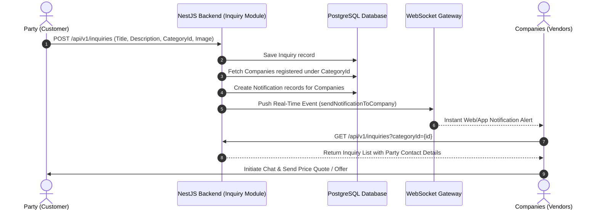

# 📋 Inquiry (ইনকোয়ারি) Module Flow Documentation

এই ডকুমেন্টে **Inquiry (ইনকোয়ারি)** মডিউলের সম্পূর্ণ বিজনেস লজিক, ডাটাফ্লো, নোটিফিকেশন সিস্টেম, এবং REST API এন্ডপয়েন্টগুলো বিস্তারিত আলোচনা করা হলো।

---

## 🔄 1. High-Level Flow Overview



---

## 👤 2. Roles & Permissions

| Role | Operations Allowed | Description |
| :--- | :--- | :--- |
| **PARTY** | `POST`, `GET`, `PATCH`, `DELETE` | পার্টি বা কাস্টমার ক্যাটাগরি সিলেক্ট করে নতুন ইনকোয়ারি সাবমিট করতে পারে এবং নিজের ইনকোয়ারি এডিট/ডিলিট করতে পারে। |
| **VENDOR** | `GET` | ভেন্ডর বা কোম্পানি তাদের নিজ নিজ ক্যাটাগরিতে আসা ইনকোয়ারিগুলো দেখতে পারে। |
| **ADMIN / SUPER_ADMIN** | `GET` | এডমিন সিস্টেমে থাকা সকল ইনকোয়ারি মনিটর করতে পারে। |

---

## ⚡ 3. Detailed Step-by-Step Flow

### **Step 1: Inquiry Submission (Party)**
- **Endpoint**: `POST /api/v1/inquiries` (Auth Guard: `AccessTokenGuard`, Role: `PARTY`)
- **Content-Type**: `multipart/form-data`
- **Request Body**:
  - `title` *(String, Required)*: ইনকোয়ারির শিরোনাম (যেমন: "৫০ বস্তা ৩১৬ গ্রেড সিমেন্ট প্রয়োজন")
  - `description` *(String, Required)*: বিস্তারিত বিবরণ ও ডেলিভারি লোকেশন
  - `categoryId` *(UUID, Required)*: যে ক্যাটাগরির প্রোডাক্ট লাগবে
  - `image` *(File, Optional)*: প্রোডাক্টের নমুনা ছবি (`/uploads/inquiries/...` এ সেভ হয়)

### **Step 2: Database Persistence & Validation**
- সিস্টেম প্রথমে `categoryId` এবং `partyId` ডাটাবেজে ভ্যালিড কি না যাচাই করে।
- ইনকোয়ারিটি `inquiries` টেবিলে সেভ করা হয়।

### **Step 3: Automated Real-time Notification Dispatch**
- ব্যাকএন্ড উক্ত `categoryId`-র অধীনস্থ সকল সক্রিয় **Company (Vendor)** খুঁজে বের করে।
- তাদের জন্য ডাটাবেজে নোটিফিকেশন (`Notification` table) অটোমেটিক ক্রিয়েট করে:
  - **Title**: `নতুন ইনকোয়ারি (New Inquiry)`
  - **Message**: `আপনার ক্যাটাগরিতে একটি নতুন ইনকোয়ারি জমা হয়েছে: "{title}"`
- নোটিফিকেশন গেটওয়ে (`NotificationGateway`) দিয়ে লাইভ WebSocket পpush নোটিফিকেশন পাঠানো হয়।

### **Step 4: Discovery & Response (Company/Vendor)**
- নোটিফিকেশন পেয়ে কোম্পানি ইনকোয়ারির ডিটেইলস দেখে (`GET /api/v1/inquiries/:id`)।
- ইনকোয়ারি রেসপন্সে কাস্টমারের (Party) নাম, ফোন নম্বর, ইমেইল এবং জেলা/উপজেলা ঠিকানা অন্তর্ভুক্ত থাকে।
- কোম্পানি ইনকোয়ারির উপর ভিত্তি করে পার্টিকে সরাসরি **Chat System** (`POST /api/v1/chat/conversations`) এর মাধ্যমে কাস্টম অফার/প্রাইস প্রপোজাল পাঠায়।

---

## 📡 4. REST API Endpoint Reference

### 1. Submit Inquiry
- **Method**: `POST`
- **Path**: `/api/v1/inquiries`
- **Headers**: `Authorization: Bearer <PARTY_ACCESS_TOKEN>`
- **Body**: Form-data (`title`, `description`, `categoryId`, `image`)

### 2. Get All Inquiries
- **Method**: `GET`
- **Path**: `/api/v1/inquiries`
- **Query Params**:
  - `categoryId` *(Optional)*: নির্দিষ্ট ক্যাটাগরির ইনকোয়ারি ফিল্টার করতে
  - `partyId` *(Optional)*: নির্দিষ্ট পার্টির ইনকোয়ারি ফিল্টার করতে
  - `page` *(Default: 1)*, `limit` *(Default: 10)*
- **Response**: Paginated List of Inquiries with Party and Category details.

### 3. Get Inquiry Details
- **Method**: `GET`
- **Path**: `/api/v1/inquiries/:id`
- **Headers**: `Authorization: Bearer <ACCESS_TOKEN>`

### 4. Update Inquiry
- **Method**: `PATCH`
- **Path**: `/api/v1/inquiries/:id`
- **Headers**: `Authorization: Bearer <PARTY_ACCESS_TOKEN>`
- **Rules**: শুধুমাত্র যে পার্টি ইনকোয়ারি ক্রিয়েট করেছে সে-ই আপডেট করতে পারবে।

### 5. Delete Inquiry
- **Method**: `DELETE`
- **Path**: `/api/v1/inquiries/:id`
- **Headers**: `Authorization: Bearer <PARTY_ACCESS_TOKEN>`
- **Rules**: শুধুমাত্র যে পার্টি ক্রিয়েট করেছে সে-ই ডিলিট করতে পারবে।

---

## 🗄️ 5. Database Schema (Prisma)

```prisma
model Inquiry {
  inquiryId     String         @id @default(uuid()) @map("inquiry_id")
  title         String
  description   String
  imageUrl      String?        @map("image_url")
  partyId       String         @map("party_id")
  party         Party          @relation(fields: [partyId], references: [partyId], onDelete: Cascade)
  categoryId    String         @map("category_id")
  category      Category       @relation(fields: [categoryId], references: [categoryId], onDelete: Cascade)
  notifications Notification[]

  createdAt DateTime @default(now()) @map("created_at")
  updatedAt DateTime @updatedAt @map("updated_at")

  @@index([partyId])
  @@index([categoryId])
  @@map("inquiries")
}
```
