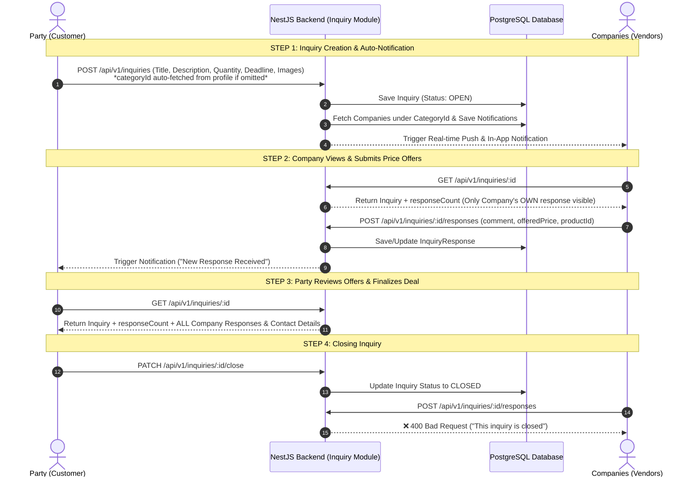

# 📋 Inquiry (ইনকোয়ারি) Module Flow Documentation

এই ডকুমেন্টে **Inquiry (ইনকোয়ারি) & Response (রেসপন্স)** মডিউলের বর্তমান সম্পূর্ণ বিজনেস লজিক, ডাটাফ্লো, প্রাইভেসি রুলস, নোটিফিকেশন সিস্টেম, প্রিজমা স্কিমা এবং REST API এন্ডপয়েন্টগুলো বিস্তারিত আলোচনা করা হলো।

---

## 🔄 1. High-Level Flow Overview



---

## 👤 2. Roles & Permissions

| Role | Operations Allowed | Description |
| :--- | :--- | :--- |
| **PARTY** | `POST`, `GET`, `PATCH`, `DELETE`, `PATCH /close` | নতুন ইনকোয়ারি তৈরি, নিজের পোস্ট দেখা/ক্লোজ করা এবং কোম্পানীগুলোর দেওয়া সকল প্রাইস অফার পর্যালোচনা করা। |
| **VENDOR** | `GET`, `POST /responses` | তাদের ক্যাটাগরিতে আসা ইনকোয়ারি দেখা এবং প্রাইস অফার/কমেন্ট প্রপোজাল সাবমিট করা। (অন্য কোম্পানির অফার হাইড থাকে)। |
| **ADMIN / SUPER_ADMIN** | `GET`, `DELETE` | সিস্টেমে থাকা সকল ইনকোয়ারি ও কোম্পানি রেসপন্স মনিটর ও মডারেট করা। |

---

## ⚡ 3. Detailed Step-by-Step Flow

### **Step 1: Inquiry Submission (Party)**
- **Endpoint**: `POST /api/v1/inquiries` (Auth: `PARTY`)
- **Content-Type**: `multipart/form-data`
- **Request Body**:
  - `title` *(String, Required)*: ইনকোয়ারির শিরোনাম
  - `productName` *(String, Optional)*: কাঙ্ক্ষিত প্রোডাক্টের নাম
  - `description` *(String, Required)*: বিস্তারিত বিবরণ
  - `quantity` *(String, Optional)*: কি পরিমাণ লাগবে (যেমন: "১০০০ বস্তা")
  - `deadline` *(Date, Optional)*: কত তারিখের মধ্যে লাগবে (`YYYY-MM-DD`)
  - `categoryId` *(UUID, Optional)*: না দিলে পার্টির নিজস্ব প্রোফাইল থেকে ক্যাটাগরি আইডি অটো সিলেক্ট হয়।
  - `images` *(Multiple Files, Optional)*: প্রোডাক্টের নমুনা একাধিক ছবি (Max 5 images).

---

### **Step 2: Automated Company Notification**
- ব্যাকএন্ড উক্ত `categoryId`-র অধীনস্থ সকল সক্রিয় **Company (Vendor)** খুঁজে বের করে।
- ডাটাবেজে নোটিফিকেশন রেকর্ড ক্রিয়েট করে এবং FCM Push Notification পাঠায়:
  > *"আপনার ক্যাটাগরিতে একটি নতুন ইনকোয়ারি এসেছে: {title}"*

---

### **Step 3: Company Views & Submits Offers (Vendor)**
- **View Inquiry**: `GET /api/v1/inquiries/:id`
  - **Privacy Enforcement**: কোম্পানি দেখতে পারবে মোট কতজন রেসপন্স করেছে (`responseCount`), কিন্তু `responses` অ্যারেতে **শুধুমাত্র তার নিজের অফারটি দেখতে পারবে**। অন্য প্রতিযোগীদের অফার গোপন থাকে।
- **Submit Response**: `POST /api/v1/inquiries/:id/responses`
  - **Body**:
    - `comment` *(String)*: ডেলিভারি শর্ত বা মেসেজ
    - `offeredPrice` *(Float)*: একক প্রতি অফার প্রাইস (টাকায়)
    - `productId` *(UUID, Optional)*: পার্টির সরাসরি অর্ডারের জন্য কোম্পানির প্রোডাক্ট আইডি
  - পার্টি নোটিফিকেশন পায়: *"কোম্পানি {companyName} আপনার ইনকোয়ারিতে একটি রেসপন্স পাঠিয়েছে।"*

---

### **Step 4: Party Reviews All Offers & Closes Inquiry**
- **Review**: পার্টি `GET /api/v1/inquiries/:id` দিলে সব কোম্পানির দেওয়া অফার, মোবাইল নম্বর ও প্রাইস দেখতে পারবে।
- **Close Inquiry**: ডিল ফাইনাল হলে পার্টি `PATCH /api/v1/inquiries/:id/close` কল করে পোস্টটি বন্ধ করবে।
- **Enforcement**: স্ট্যাটাস `CLOSED` হয়ে গেলে নতুন কোনো রেসপন্স সাবমিট করা যাবে না (`400 Bad Request`).

---

## 📡 4. REST API Endpoint Reference

### 1. Submit Inquiry
- **Method**: `POST` | **Path**: `/api/v1/inquiries`
- **Headers**: `Authorization: Bearer <PARTY_ACCESS_TOKEN>`
- **Body**: Form-data (`title`, `productName`, `description`, `quantity`, `deadline`, `categoryId`, `images`)

### 2. Get All Inquiries
- **Method**: `GET` | **Path**: `/api/v1/inquiries`
- **Query Params**: `categoryId`, `partyId`, `page`, `limit`
- **Response**: Role-filtered Paginated List of Inquiries.

### 3. Get Inquiry Details (With Privacy Rules)
- **Method**: `GET` | **Path**: `/api/v1/inquiries/:id`
- **Headers**: `Authorization: Bearer <ACCESS_TOKEN>`

### 4. Submit Company Response / Price Offer
- **Method**: `POST` | **Path**: `/api/v1/inquiries/:id/responses`
- **Headers**: `Authorization: Bearer <VENDOR_ACCESS_TOKEN>`
- **Body**: `{ "comment": "...", "offeredPrice": 520, "productId": "..." }`

### 5. Close Inquiry (Party Owner Only)
- **Method**: `PATCH` | **Path**: `/api/v1/inquiries/:id/close`
- **Headers**: `Authorization: Bearer <PARTY_ACCESS_TOKEN>`

---

## 🗄️ 5. Database Schema (Prisma)

```prisma
enum InquiryStatus {
  OPEN
  CLOSED
}

model Inquiry {
  inquiryId   String        @id @default(uuid()) @map("inquiry_id")
  title       String
  productName String?       @map("product_name")
  description String
  quantity    String?
  deadline    DateTime?
  status      InquiryStatus @default(OPEN)
  imageUrls   String[]      @default([]) @map("image_urls")

  partyId   String @map("party_id")
  party     Party  @relation(fields: [partyId], references: [partyId], onDelete: Cascade)

  categoryId String   @map("category_id")
  category   Category @relation(fields: [categoryId], references: [categoryId], onDelete: Cascade)

  responses     InquiryResponse[]
  notifications Notification[]

  createdAt DateTime @default(now()) @map("created_at")
  updatedAt DateTime @updatedAt @map("updated_at")

  @@index([partyId])
  @@index([categoryId])
  @@map("inquiries")
}

model InquiryResponse {
  responseId   String   @id @default(uuid()) @map("response_id")
  comment      String?
  offeredPrice Float?    @map("offered_price")

  productId String?  @map("product_id")
  product   Product? @relation(fields: [productId], references: [productId], onDelete: SetNull)

  companyId String  @map("company_id")
  company   Company @relation(fields: [companyId], references: [companyId], onDelete: Cascade)

  inquiryId String  @map("inquiry_id")
  inquiry   Inquiry @relation(fields: [inquiryId], references: [inquiryId], onDelete: Cascade)

  createdAt DateTime @default(now()) @map("created_at")
  updatedAt DateTime @updatedAt @map("updated_at")

  @@unique([inquiryId, companyId])
  @@index([inquiryId])
  @@index([companyId])
  @@map("inquiry_responses")
}
```
