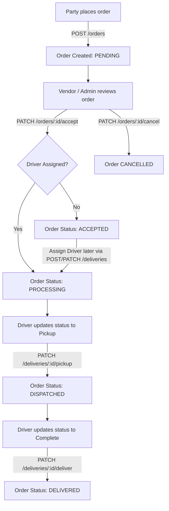
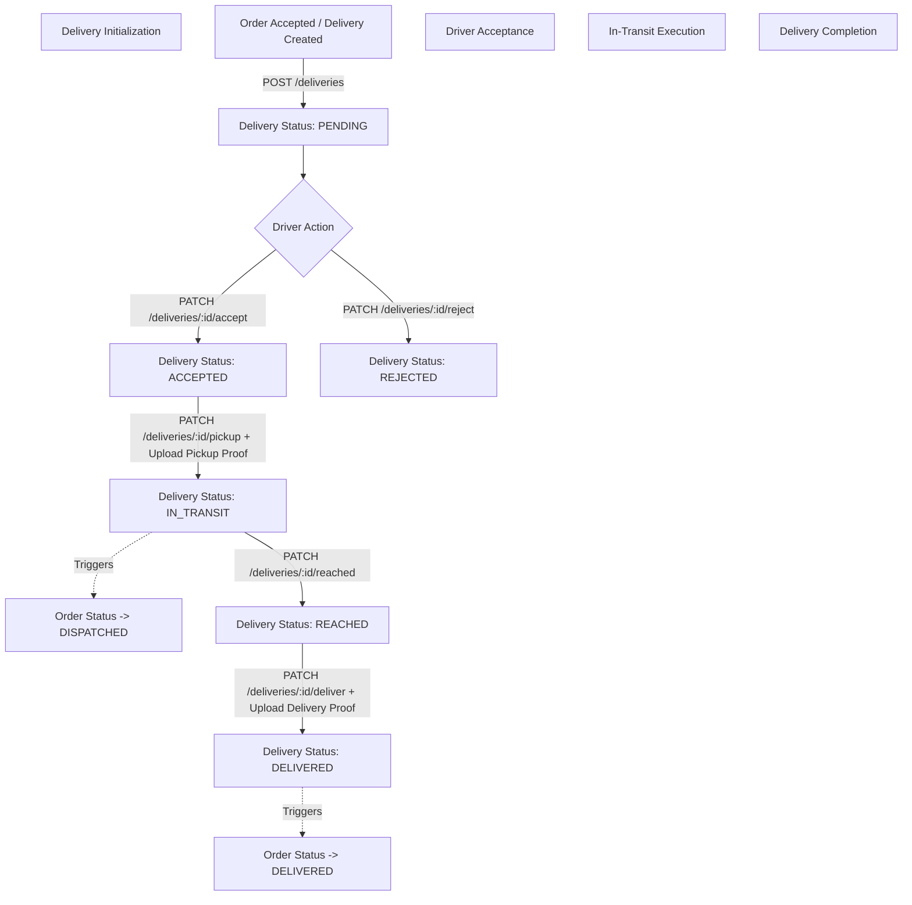

# Order Flow & Delivery Flow Documentation

This document provides a comprehensive end-to-end overview of the **Order Flow** and **Delivery Flow** in the DOR Backend application, including entity schemas, state transitions, API endpoints, role permissions, and visual Mermaid flow diagrams.

---

## 1. Overview & Data Architecture

The logistics module connects four primary actors:
- **Party (Customer)**: Places product orders and receives delivery status updates.
- **Vendor (Company)**: Manages incoming orders, accepts/cancels orders, and assigns drivers.
- **Driver**: Accepts delivery requests, updates real-time delivery status, uploads proofs (pickup/delivery), and completes shipments.
- **Admin / Super Admin**: Oversees system-wide order management, category-based permissions, and driver management.

### Key Data Entities

```
+----------------+          +----------------+          +-------------------+
|     Order      | 1      * |    Delivery    | *      1 |      Driver       |
+----------------+----------+----------------+----------+-------------------+
| orderId (UUID) |          | deliveryId     |          | driverId (UUID)   |
| showOrderId    |          | status         |          | driverName        |
| companyId      |          | driverId       |          | phoneNumber       |
| partyId        |          | orderId        |          | truckNumber       |
| productId      |          | pickupProof    |          | lat, long         |
| bag, bagSize   |          | deliveryProof  |          +-------------------+
| totalRate      |          | deliveryTime   |
| status         |          | lat, long      |
+----------------+          +----------------+
```

---

## 2. Order Flow

### 2.1 Order Status Lifecycle (`OrderStatus`)

```
                          [ Order Placed ]
                                 │
                                 ▼
                             ( PENDING )
                                 │
                       Vendor/Admin Accepts
                                 │
                                 ▼
                            ( ACCEPTED )
                                 │
                       Driver Assigned to Delivery
                                 │
                                 ▼
                           ( PROCESSING )
                                 │
                         Driver Picks Up Goods
                                 │
                                 ▼
                           ( DISPATCHED )
                                 │
                        Driver Completes Delivery
                                 │
                                 ▼
                            ( DELIVERED )
```

> **Note on Cancellation**: An order can be moved to **`CANCELLED`** by Vendor/Admin at any point prior to reaching `DELIVERED` status.

---

### 2.2 Detailed Order Step-by-Step Flow

| Step | Action | Initiator / Role | API Endpoint | Description & Status Transition |
| :--- | :--- | :--- | :--- | :--- |
| **1** | **Create Order** | Party / Customer | `POST /api/v1/orders` | Creates a new order in `PENDING` status. Derives `companyId` from `productId`. Automatically initializes a linked `Delivery` record. |
| **2** | **View Orders** | Party / Vendor / Admin | `GET /api/v1/orders` | Lists orders filtered by role, search query, status, and company/party scoping. |
| **3** | **Accept & Assign Driver** | Vendor / Admin | `PATCH /api/v1/orders/:id/accept` | Changes order status to `ACCEPTED`. Optional `driverId` parameter links driver to the `Delivery` record. Emits WebSocket & DB Notification to Party. |
| **4** | **Processing** | System / Vendor | Automatic | Once a `Delivery` record has both `orderId` and `driverId`, order status shifts to `PROCESSING`. |
| **5** | **Dispatched (In-Transit)** | Driver | `PATCH /api/v1/deliveries/:id/pickup` | When driver picks up order and uploads `pickupProof`, order status shifts to `DISPATCHED`. |
| **6** | **Delivered** | Driver | `PATCH /api/v1/deliveries/:id/deliver` | When driver completes delivery and uploads `deliveryProof`, order status shifts to `DELIVERED`. |
| **7** | **Generate Invoice** | Party / Vendor / Admin | `GET /api/v1/orders/:id/invoice` | Generates a detailed JSON invoice with seller, buyer, item subtotal, tax, and total pricing details. |
| **8** | **Cancel Order** | Vendor / Admin | `PATCH /api/v1/orders/:id/cancel` | Cancels order (if not already `DELIVERED` or `CANCELLED`) and sends notification to customer. |

---

### 2.3 Order Flow Diagram (Mermaid)



---

## 3. Delivery Flow

### 3.1 Delivery Status Lifecycle (`DeliveryStatus`)

```
                             [ Delivery Created ]
                                      │
                                      ▼
                                  ( PENDING )
                                   │     │
                 Driver Accepts ───┘     └─── Driver Rejects
                        │                         │
                        ▼                         ▼
                   ( ACCEPTED )              ( REJECTED )
                        │
                  Driver Picked Up
                        │
                        ▼
                  ( IN_TRANSIT )
                        │
                  Driver Reached Location
                        │
                        ▼
                    ( REACHED )
                        │
                  Driver Completed Delivery
                        │
                        ▼
                   ( DELIVERED )
```

---

### 3.2 Detailed Delivery Step-by-Step Flow

| Step | Action | Actor / Role | API Endpoint | Details & Side Effects |
| :--- | :--- | :--- | :--- | :--- |
| **1** | **Delivery Creation** | System / Vendor / Admin | `POST /api/v1/deliveries` | Creates a delivery entry linked to `orderId` and `driverId`. Default status: `PENDING`. Updates Order status to `PROCESSING`. |
| **2** | **Driver Accept Delivery** | Driver | `PATCH /api/v1/deliveries/:id/accept` | Driver accepts the assignment. Delivery status changes to `ACCEPTED`. Activity logged. |
| **3** | **Driver Reject Delivery** | Driver | `PATCH /api/v1/deliveries/:id/reject` | Driver declines the assignment. Delivery status changes to `REJECTED`. |
| **4** | **Pickup Goods** | Driver | `PATCH /api/v1/deliveries/:id/pickup` | Driver uploads `pickupProof` image. Delivery status changes to `IN_TRANSIT`. Sets `startDeliveryTime`. **Syncs Order status to `DISPATCHED`**. |
| **5** | **Reached Location** | Driver | `PATCH /api/v1/deliveries/:id/reached` | Driver arrives at party address. Delivery status changes to `REACHED`. |
| **6** | **Complete Delivery** | Driver | `PATCH /api/v1/deliveries/:id/deliver` | Driver uploads `deliveryProof` image. Delivery status changes to `DELIVERED`. Sets `endDeliveryTime`. **Syncs Order status to `DELIVERED`**. |
| **7** | **Tracking & Timeline** | Party / Vendor / Admin | `GET /api/v1/orders/:id` | Returns complete tracking timeline including pickup proof, arrival times, current location, and driver contact info. |

---

### 3.3 Delivery Flow Diagram (Mermaid)



---

## 4. Real-time Order & Delivery Tracking Timeline

When calling `GET /api/v1/orders/:id`, the system automatically constructs a 6-stage **Tracking Timeline**:

1. **অর্ডার গ্রহণ করা হয়েছে (Order Accepted)**: Order is accepted by vendor.
2. **পিকআপ পয়েন্টে পৌঁছেছে (Reached Pickup)**: Driver reaches pickup location.
3. **পণ্য সংগ্রহ করা হয়েছে (Picked Up)**: Goods collected + `pickupProof` image path.
4. **ডেলিভারি শুরু হয়েছে (Delivery Started)**: In-transit state with driver's live coordinates (`lat`, `long`).
5. **গন্তব্যের কাছাকাছি (Near Destination)**: Driver status updated to `REACHED`.
6. **ডেলিভারি সম্পন্ন (Delivery Completed)**: Delivery finished + `deliveryProof` image path + completion timestamp.

---

## 5. Security & Access Control Matrix

| Endpoint | Party | Vendor | Driver | Admin / Super Admin |
| :--- | :---: | :---: | :---: | :---: |
| `POST /orders` | ✅ | ✅ | ❌ | ✅ |
| `GET /orders` | Scoped (Own) | Scoped (Company) | Scoped (Assigned) | ✅ All / Category Scoped |
| `PATCH /orders/:id/accept` | ❌ | Scoped (Own) | ❌ | ✅ |
| `PATCH /orders/:id/cancel` | ❌ | Scoped (Own) | ❌ | ✅ |
| `PATCH /deliveries/:id/accept` | ❌ | ❌ | Scoped (Assigned) | ✅ |
| `PATCH /deliveries/:id/pickup` | ❌ | ❌ | Scoped (Assigned) | ✅ |
| `PATCH /deliveries/:id/deliver` | ❌ | ❌ | Scoped (Assigned) | ✅ |
